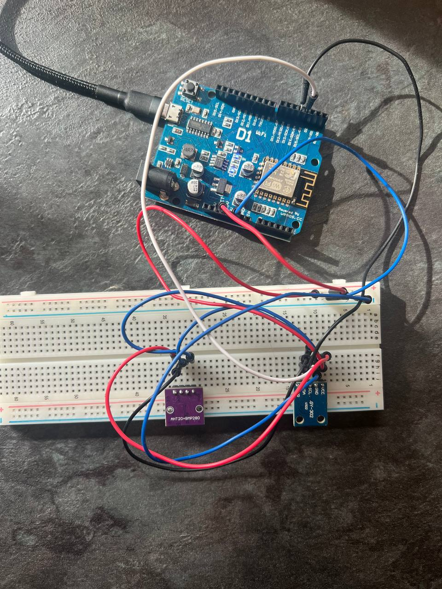

# Environmental Sensor Logger

Environmental Sensor Logger is an embedded monitoring device based on the WeMos D1 R1 (ESP8266).

The device measures temperature, humidity, atmospheric pressure, and light intensity, outputs structured JSON data through the serial port, and saves measurements to flash memory in CSV format.

## Project Level

**Standard — "It's a Real Device"**

Implemented features:

- multiple physical sensors;
- configurable measurement interval;
- structured JSON serial output;
- CSV logging to flash memory;
- state machine: `IDLE`, `RUNNING`, `ERROR`;
- serial command interface;
- sensor value validation;
- command timeout handling;
- flash storage error handling;
- UTC time synchronization through NTP;
- persistent log storage using LittleFS.

## Hardware

### Microcontroller

- WeMos D1 R1
- ESP8266
- Arduino framework
- PlatformIO + Visual Studio Code

### Sensors

- AHT20 — temperature and humidity
- BMP280 — atmospheric pressure
- BH1750 — light intensity

The AHT20 and BMP280 are installed on one combined sensor module.

## Measurements

| Parameter | Sensor | Unit |
|---|---|---|
| Temperature | AHT20 | °C |
| Humidity | AHT20 | % |
| Atmospheric pressure | BMP280 | hPa |
| Light intensity | BH1750 | lx |

## Personal Twist

The project is implemented as an **environmental / weather monitoring station**.

Its purpose is to collect environmental data in a room or another monitored area and preserve measurements for later analysis. In addition to temperature, humidity, and atmospheric pressure, the device also measures ambient light intensity.

## Wiring

The sensors communicate with the ESP8266 through the I2C bus.

### ESP8266 I2C pins

| Function | ESP8266 GPIO |
|---|---:|
| SDA | GPIO4 |
| SCL | GPIO5 |
| Power | 3.3 V |
| Ground | GND |

### BH1750

| BH1750 | Connection |
|---|---|
| VCC | 3.3 V |
| GND | GND |
| SDA | GPIO4 |
| SCL | GPIO5 |
| ADDR | not connected |

I2C address: `0x23`

### AHT20 + BMP280 module

| Module | Connection |
|---|---|
| VDD | 3.3 V |
| GND | GND |
| SDA | GPIO4 |
| SCL | GPIO5 |

I2C addresses:

- AHT20: `0x38`
- BMP280: `0x77`

A detailed wiring description is available in `docs/wiring-diagram.md`.

## State Machine

The firmware uses three main states:

- `IDLE` — device is ready but sensor logging is stopped;
- `RUNNING` — sensors are periodically read and measurements are logged;
- `ERROR` — a critical sensor or storage error has occurred.

```text
              START
       +----------------+
       |                v
     IDLE ----------> RUNNING
       ^                |
       |                |
       +------ STOP ----+
                        |
                        | critical error
                        v
                      ERROR
```

See `docs/state-machine.md`.

## Serial Commands

- `START` — starts sensor logging.
- `STOP` — stops sensor logging and returns the device to `IDLE`.
- `STATUS` — displays the current device state and configuration.
- `SET_INTERVAL 500` — changes the measurement interval. Allowed range: `100–60000 ms`.
- `DUMP_LOG` — prints the CSV log stored in flash memory.
- `CLEAR_LOG` — clears stored measurement data.

## Structured Serial Output

Sensor readings are sent as one-line JSON messages.

```json
{"type":"reading","timestamp":"2026-10-15T10:05:12Z","time_synced":true,"temperature_c":21.35,"humidity_pct":56.10,"pressure_hpa":999.60,"light_lx":18.33,"status":"OK"}
```

The complete protocol description is available in `docs/message-format.md`.

## Flash Logging

Measurements are stored in ESP8266 flash memory using LittleFS.

Log file: `/sensor_log.csv`

```csv
timestamp,time_synced,temperature_c,humidity_pct,pressure_hpa,light_lx,status
2026-10-15T10:05:12Z,true,21.35,56.10,999.60,18.33,OK
2026-10-15T10:05:13Z,true,21.36,56.09,999.61,17.50,OK
```

The file remains stored after the device loses power.

## Timing

The main measurement loop uses a non-blocking timer based on `millis()` instead of `delay()`:

```cpp
if (currentTime - lastReadMs >= intervalMs) {
    lastReadMs = currentTime;
    readSensors();
}
```

This allows the firmware to continue processing serial commands while waiting for the next measurement.

## Error Handling

### Sensor initialization failure
If one of the sensors cannot be initialized, the device enters the `ERROR` state.

### Invalid sensor values
Sensor readings are validated before logging. Accepted ranges:

- temperature: `-40 ... 85 °C`;
- humidity: `0 ... 100 %`;
- pressure: `300 ... 1100 hPa`;
- light intensity: `0 ... 120000 lx`.

Three consecutive invalid measurements cause the device to enter the `ERROR` state.

### Invalid commands
Unknown commands return an error response.

### Command timeout
An incomplete serial command is automatically discarded after 3 seconds.

### Flash error
If writing to LittleFS fails, the device enters the `ERROR` state.

## UTC Time

The ESP8266 connects to Wi-Fi during startup and synchronizes its clock using NTP.

Timestamps use UTC ISO 8601 format, for example: `2026-10-15T10:05:12Z`.

Wi-Fi credentials are stored separately in `include/secrets.h`. This file must not be committed to a public repository.

## Build and Upload

Requirements:

- Visual Studio Code
- PlatformIO extension
- USB driver for CH340
- WeMos D1 R1 connected through USB

Build: `Ctrl + Alt + B`

Upload firmware: `Ctrl + Alt + U`

Serial Monitor: `Ctrl + Shift + P` → `PlatformIO: Serial Monitor`

Serial speed: `115200 baud`.

## Libraries

- BH1750
- Adafruit AHTX0
- Adafruit BMP280
- Wire
- LittleFS
- ESP8266WiFi

External libraries are configured in `platformio.ini`.

## Device Photo



## Demo

The demonstration should show:

1. device startup;
2. successful sensor initialization;
3. `STATUS`;
4. `START`;
5. live environmental measurements;
6. changing light values by covering or illuminating the BH1750;
7. `SET_INTERVAL`;
8. `STOP`;
9. persistent CSV data using `DUMP_LOG`.

